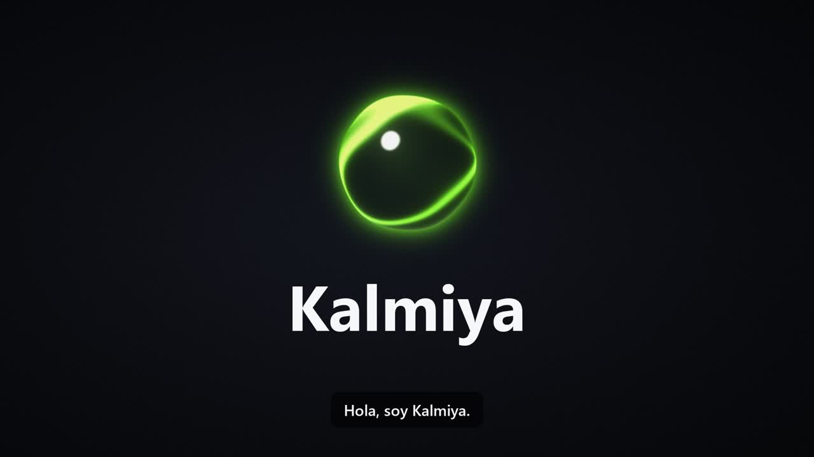

<p align="center"></p>
<h1 align="center">Kalmiya</h1>
<p align="center">
  <b>Tu asistente de voz 100 % local para Windows y Linux.</b><br>
  <i>A private, offline voice assistant for Windows &amp; Linux — Spanish &amp; English.</i>
</p>
<p align="center">
  <a href="https://github.com/jcrow0526/kalmiya/releases/latest"></a>
  
  
  
  <a href="LICENSE"></a>
</p>
<p align="center">
  <a href="https://github.com/jcrow0526/kalmiya/releases/download/v0.1.1/KalmiyaSetup.exe"><b>⬇ Windows</b></a> ·
  <a href="#-linux--omarchy"><b>🐧 Linux / Omarchy</b></a> ·
  <a href="docs/">Landing page</a> ·
  <a href="#-qué-le-puedes-pedir">Qué hace</a>
</p>

<p align="center"></p>

Mantén **Ctrl + Alt + Espacio**, habla y suelta. Kalmiya transcribe tu voz con **Whisper**, decide qué
hacer con **LFM3‑1.7B** (Liquid AI) y te responde en voz alta con **Piper**. Todo corre en tu equipo:
sin cuenta, sin nube, sin enviar tu voz a nadie.

> **EN** — Hold **Ctrl+Alt+Space**, talk, release. Kalmiya transcribes your voice with Whisper, decides what to
> do with Liquid AI's **LFM3** and answers out loud with Piper. It plays music, opens apps, closes tabs, manages
> your calendar and reminders, reads the news, writes WhatsApp messages (always asking before sending), answers
> questions about images on your screen — and on **Omarchy** it drives the whole desktop.

## 🎬 Kalmiya × Omarchy

Grabaciones reales de pantalla en [Omarchy](https://omarchy.org): cambiar el tema, poner una película,
pantalla completa, cerrar la pestaña, consultar la memoria, crear un recordatorio, abrir el bloc de notas y
dictar, todo con la voz. *Real screen recordings: theme, video, fullscreen, tabs, system info, reminders and
dictation, all by voice.*

<table>
  <tr>
    <td align="center" width="50%">
      <a href="https://github.com/jcrow0526/kalmiya/releases/download/v0.2.0/Kalmiya_Omarchy_ES.mp4"></a><br>
      <b>🇲🇽 Español</b>
    </td>
    <td align="center" width="50%">
      <a href="https://github.com/jcrow0526/kalmiya/releases/download/v0.2.0/Kalmiya_Omarchy_EN.mp4"></a><br>
      <b>🇺🇸 English</b>
    </td>
  </tr>
</table>

## ✨ Lo esencial

|  |  |
|---|---|
| 🎙️ **Habla y suelta** | Ctrl+Alt+Espacio para órdenes, **Ctrl+Alt+D** para dictar en cualquier app (inspirado en [Handy](https://github.com/cjpais/Handy)). |
| ⚡ **Rápida** | ~0.56 s desde que sueltas el atajo hasta que oyes la respuesta (RTX 4070 Laptop). |
| 🔒 **Privada** | Whisper, LFM3 y Piper corren en tu PC. Funciona sin internet, salvo para lo que lo necesita (YouTube, clima, noticias). |
| 🧠 **Entiende el contexto** | Sabe qué ventana y qué pestaña tienes abiertas: «cierra esta pestaña», «pon esto en pantalla completa». |
| 🤔 **Pregunta cuando duda** | «¿Dijiste…?», y siempre antes de enviar un mensaje o apagar el equipo. |
| 🖥️ **Omarchy** | Escritorios, temas, fondos, luz nocturna, capturas, OCR, grabación de pantalla, menús y paneles. |
| 🌎 **Español e inglés** | Voces Daniela (es_AR), Claude (es_MX) y Lessac (en_US). |
| 🔮 **Orbe y burbuja de vidrio** | Un orbe 3D que se mueve con tu voz y una burbuja «liquid glass» con la respuesta. |

## ⬇ Instalar

### 🪟 Windows

1. Descarga **[KalmiyaSetup.exe](https://github.com/jcrow0526/kalmiya/releases/download/v0.1.1/KalmiyaSetup.exe)** y ábrelo
   (o doble clic en `Instalar.bat` desde el código).
2. Mantén **Ctrl + Alt + Espacio** y habla.

Windows puede mostrar «Windows protegió tu PC» porque el instalador no está firmado: *Más información →
Ejecutar de todos modos*. Requisitos: Windows 10/11 de 64 bits, 8 GB de RAM, ~8 GB de disco; GPU NVIDIA
recomendada.

<details>
<summary>Qué hace el instalador de Windows</summary>

Por dentro ([installer/install.ps1](installer/install.ps1)):

1. Instala `uv` y un Python 3.12 aislado (no toca el Python del sistema).
2. Descarga `llama-server` de llama.cpp (CUDA si detecta NVIDIA, si no CPU).
3. Descarga LFM3‑1.7B (~1 GB), LFM3‑VL‑2B para imágenes (~1.2 GB, opcional), Whisper y las voces
   (Daniela es_AR, Claude es_MX, Lessac en_US). Con NVIDIA usa Whisper `large-v3-turbo`; sin GPU, `small`.
4. Crea accesos en Inicio, Escritorio y arranque automático.

Todo queda en `%LOCALAPPDATA%\Kalmiya` (una instalación anterior de *Eco* se migra sola, con sus modelos).
Para quitarlo: menú Inicio → *Desinstalar Kalmiya*. En consola: `installer\install.ps1 -Gpu vulkan`
(AMD/Intel), `-Quant Q8_0`, `-NoStartup`, `-NoVision`, `-Nemotron`.

Para generar un `KalmiyaSetup.exe`, con [Inno Setup 6](https://jrsoftware.org/isinfo.php):
`iscc installer\kalmiya.iss` → `dist\KalmiyaSetup.exe`.
</details>

### 🐧 Linux / Omarchy

```bash
curl -L https://github.com/jcrow0526/kalmiya/releases/latest/download/Kalmiya-linux.tar.gz | tar xz
cd kalmiya && ./Instalar.sh      # opciones: --gpu cuda|vulkan|cpu, --quant Q8_0, --no-vision, --no-startup
```

Probado en [Omarchy](https://omarchy.org) (Arch + Hyprland con configuración en Lua). El instalador
([installer/install.sh](installer/install.sh)) instala con pacman lo que falte (`wtype`, `wl-clipboard`,
`grim`, `slurp`, `tesseract`, `gtk4-layer-shell`, `libayatana-appindicator`), crea un Python 3.12 aislado con
`uv`, descarga `llama-server` (CUDA 12 si hay NVIDIA), los modelos y el OCR de Tesseract, y deja todo en
`~/.local/share/kalmiya`. Para quitarlo: *Desinstalar Kalmiya* en el lanzador o
`bash ~/.local/share/kalmiya/app/uninstall.sh`.

**Con Omarchy, Kalmiya maneja también el escritorio** ([kalmiya/linux/omarchy.py](kalmiya/linux/omarchy.py)):

| Di… | Hace |
|---|---|
| «Ve al escritorio 3», «manda esta ventana al 2», «flota esta ventana», «cierra todas las ventanas» | Escritorios y ventanas de Hyprland |
| «Cambia el tema a Kanagawa», «pon un tema claro», «pon otro tema», «cambia el fondo», «quita la barra» | Temas, fondos, transparencia, márgenes y barra |
| «Activa la luz nocturna», «modo no molestar», «mantén la pantalla encendida», «apaga el Bluetooth» | Ajustes rápidos |
| «Sube el brillo», «brillo al 40 por ciento» | Brillo (también monitores externos por DDC) |
| «Haz una captura de una zona», «copia el texto de la pantalla», «copia un color», «lee el código QR» | Capturas, OCR y selector de color |
| «Graba la pantalla con audio», «detén la grabación» | Grabación de pantalla |
| «Abre el menú», «abre el wifi», «enséñame los atajos», «abre el portapapeles», «abre mi agente» | Menús, paneles y apps de Omarchy |
| «Abre el bloc de notas», «borra las notificaciones» | Omawrite y notificaciones |
| «¿Cuánta memoria uso?», «¿cuánto disco me queda?», «¿qué IP tengo?», «¿hay actualizaciones?» | Estado del equipo |
| «Actualiza el sistema», «apaga / reinicia / suspende la computadora» | Siempre pregunta antes |

En inglés también: *"go to workspace 3"*, *"change the theme to Kanagawa"*, *"open the text editor"*…
Desde la terminal: `kalmiya settings`, `kalmiya calendar`, `kalmiya reminders`, `kalmiya quit`.

<details>
<summary>Qué cambia respecto a Windows</summary>

Código en [kalmiya/linux/](kalmiya/linux/):

- **Atajos:** Wayland no deja a una app leer el teclado global, así que son binds de Hyprland. Kalmiya
  escribe `~/.config/hypr/kalmiya.lua` (cargado desde `hyprland.lua`) y los binds le avisan con
  `kalmiya-ctl` por un socket local. Se cambian en *Configuración → General* (p. ej. `ctrl+alt+space`).
- **Orbe y burbuja:** un proceso con GTK 4 y gtk4-layer-shell los muestra como capa *overlay* que no
  recibe clics ni roba el foco; se dibujan con el mismo código que en Windows.
- **Ventanas y teclas:** `hyprctl` (ventana activa, enfocar, cerrar, pantalla completa), `wtype` para teclas
  y dictado (también en terminales) y un ratón virtual (uinput) para los clics en YouTube o WhatsApp Web.
- **URL del navegador:** sin UI Automation, se copia de la barra al soltar el atajo, solo si el navegador
  es la ventana activa. Las demás pestañas se buscan con el buscador de pestañas (Ctrl+Shift+A en Chromium).
- **Medios y volumen:** MPRIS (`playerctl` o `busctl`) y `wpctl`; para bajar las demás apps, `pactl`.
- **WhatsApp:** la web app de WhatsApp (la de Omarchy u otra ventana de WhatsApp Web).
- **Si la GPU está llena** (por ejemplo, otro modelo en LM Studio), Whisper y LFM3 pasan solos a la CPU:
  funciona, pero tarda varios segundos por orden.
- **Pruebas sin micrófono:** `kalmiya-ctl escuchar agente orden.wav` le da a Kalmiya un audio como si
  lo dijeras (así se grabaron los comerciales).
</details>

## 🗣️ Qué le puedes pedir

| Ejemplo | Herramienta |
|---|---|
| «Pon Bad Bunny», «ponme un video de cómo hacer tacos» | `reproducir` (primer resultado de YouTube, en la pestaña de YouTube que ya tengas; en Spotify, busca ahí) |
| «Abre el primer recomendado», «ponme el de Escocia» | `youtube_recomendado` (lee *tus* recomendados con OCR y hace clic) |
| «Cierra esta pestaña», «regresa», «pantalla completa», «minimiza esto» | `controlar_ventana` (sobre la ventana activa) |
| «Cierra la pestaña de YouTube», «ve a la pestaña de Gmail» | `pestana` (busca por título en todas las ventanas del navegador) |
| «¿Cómo está el clima?», «¿va a llover mañana en Madrid?» | `clima` (Open‑Meteo, sin clave) |
| «¿Quién es Bad Bunny?», «¿cuál es la capital de Australia?» | `buscar_info` (Wikipedia, resumido por LFM3) |
| «Ponme dentista el viernes a las 4», «¿qué tengo mañana?» | `crear_evento`, `ver_agenda` (y Google Calendar si lo conectas) |
| «Recuérdame sacar la ropa en 20 minutos / mañana a las 9» | `recordatorio` (sobrevive a reinicios) |
| «Mándale a mamá que ya voy» | `whatsapp_mensaje` (lo escribe y **pregunta siempre antes de enviar**) |
| «Resúmeme las noticias», «¿qué dice Xataka?» | `resumen_noticias` (RSS de tus periódicos) |
| «Descarga este video», «baja la canción X en mp3» | `descargar_video` (yt‑dlp) |
| «Abre Spotify», «siguiente canción», «volumen al 50 %» | `abrir_aplicacion`, `controlar_medios`, `fijar_volumen` |
| «Toma una captura», «abre descargas», «bloquea la PC» | `captura_pantalla`, `abrir_carpeta`, `bloquear_pc` |
| **Ctrl+Alt+I** → clic en una imagen → «¿qué es esto?» | LFM3‑VL‑2B (se carga al primer uso) |
| **Ctrl+Alt+N** | Nueva conversación |

Añadir una herramienta = una función con `@tool(...)` en [kalmiya/tools.py](kalmiya/tools.py).

<details>
<summary>Más detalles: contexto, volumen, Google Calendar, inglés</summary>

- **Contexto:** al pulsar el atajo, Kalmiya anota la ventana activa, la URL de la pestaña del navegador y
  las demás apps abiertas ([kalmiya/context.py](kalmiya/context.py)), y se lo da al modelo.
- **Baja el volumen mientras hablas:** las demás apps quedan al 15 % desde que pulsas el atajo hasta que
  Kalmiya termina de responder.
- **Cuando duda, pregunta:** si Whisper entendió con poca confianza, si el video no se parece a lo pedido o
  si la app solo coincide aproximadamente. Después escucha la respuesta sin pulsar el atajo: «sí» lo hace,
  «no» lo cancela y, si te callas, no hace nada.
- **Google Calendar:** calendario → *Conectar Google Calendar*. Pide una vez el JSON de un cliente OAuth tipo
  «App de escritorio» (Google Cloud → Calendar API) y abre el navegador para autorizar.
- **Inglés:** se elige en la presentación o en *Configuración → Idioma*. Whisper escucha en inglés, la voz es
  Lessac y las respuestas se traducen con LFM3 (~0.2 s extra).
</details>

## ⚡ Velocidad

RTX 4070 Laptop 8 GB y Ryzen 7 7840HS: de soltar el atajo a oír la respuesta, **~0.56 s** (Whisper 0.23 s,
LFM3 0.23 s y primer audio 0.09 s). LFM3 elige la herramienta correcta en 24 de 24 órdenes de prueba.

**Mide tu equipo:** menú Inicio → *Kalmiya Benchmark* (o `python -m kalmiya.bench`) y comparte el resultado
→ [bench/](bench/README.md) · [tabla de la comunidad](bench/RESULTS.md).

<details>
<summary>Comparativa de motores de voz a texto</summary>

| Voz a texto (5 frases en español) | Latencia/frase | Aciertos |
|---|---|---|
| **Whisper large‑v3‑turbo, GPU** (predeterminado) | 0.2 s | 5/5 |
| Whisper small, GPU | 0.1 s | 3/5 («Diogo Tube», «Kube») |
| Nemotron 3.5 ASR 0.6B, GPU | 0.03 s | 3/5 («Bad Booney en octubre») |
| Parakeet TDT 0.6B v3, GPU | 0.02 s | 4/5 («Bad Bundy en Diobtube») |
| Nemotron 3.5 Transcribe 30B‑A4B (IQ4_NL), CPU | 4–6 s | 5/5 (no cabe en 8 GB de VRAM) |
| Whisper large‑v3‑turbo, CPU | 4.4 s | 5/5 |

Para usar Nemotron: *Configuración → Motor de voz a texto → nemotron* y en *Modelo Nemotron* un alias
(`nemotron-3.5`, `parakeet-tdt`) o un GGUF en la carpeta `models/nemotron`.
</details>

## 🧩 Arquitectura

```
atajo → micrófono (sounddevice) → faster-whisper → LFM3 vía llama-server (OpenAI API + tools)
                                                         ↓ tool calls
                           kalmiya/tools.py · kalmiya/linux/omarchy.py → respuesta → Piper + orbe y burbuja
```

- [kalmiya/app.py](kalmiya/app.py) orquesta; [kalmiya/llm.py](kalmiya/llm.py) arranca llama-server y corre el bucle de agente.
- ¿Ya usas Ollama o LM Studio? Pon su URL en *Configuración → Servidor LLM externo*.
- Configuración y registros: `%LOCALAPPDATA%\Kalmiya` en Windows, `~/.local/share/kalmiya` en Linux.
- Landing page en [docs/](docs/) (HTML estático; Dockerfile incluido, puerto 80). Los recursos se regeneran
  con `python docs/make_assets.py`.

### Desarrollo

```bash
uv venv -p 3.12 && uv pip install -r requirements.txt   # Linux: requirements-linux.txt
python -m kalmiya
```

## 📄 Licencia

Código bajo [licencia MIT](LICENSE). Los modelos no se incluyen en el repositorio: el instalador los descarga
de sus autores y cada uno tiene su propia licencia: LFM3 y LFM3‑VL ([LFM Open License](https://huggingface.co/LiquidAI/LFM3-1.7B-GGUF)),
Whisper (MIT), las voces de [Piper](https://huggingface.co/rhasspy/piper-voices) (licencia de cada voz) y
[llama.cpp](https://github.com/ggml-org/llama.cpp) (MIT). Los comerciales usan *Sintel* y *Big Buck Bunny*
© Blender Foundation ([CC BY 3.0](https://creativecommons.org/licenses/by/3.0/)).
