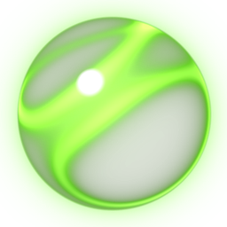
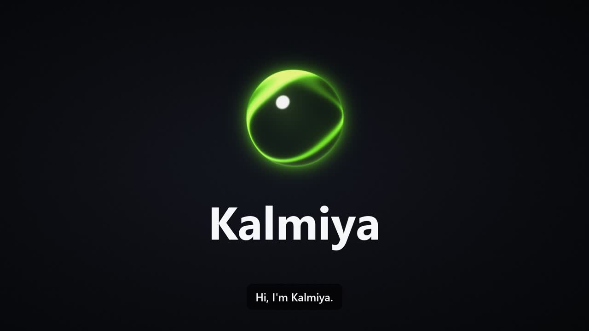
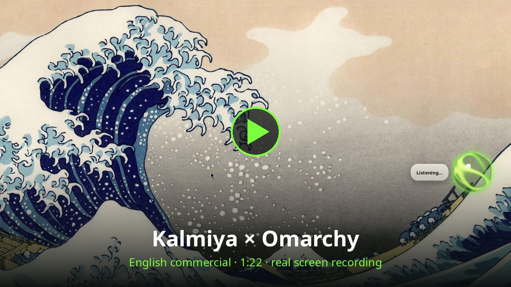
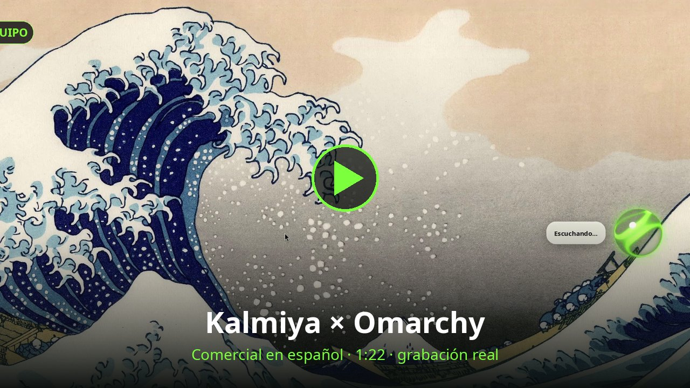

<p align="center"></p>
<h1 align="center">Kalmiya</h1>
<p align="center">
  <b>A 100% local voice assistant for Windows and Linux.</b><br>
  <i>Private and offline. Speaks English and Spanish.</i>
</p>
<p align="center"><b>English</b> · <a href="README.es.md">Español</a></p>
<p align="center">
  <a href="https://github.com/jcrow0526/kalmiya/releases/latest"></a>
  
  
  
  <a href="LICENSE"></a>
</p>
<p align="center">
  <a href="https://github.com/jcrow0526/kalmiya/releases/download/v0.1.1/KalmiyaSetup.exe"><b>⬇ Windows</b></a> ·
  <a href="#-linux--omarchy"><b>🐧 Linux / Omarchy</b></a> ·
  <a href="docs/">Landing page</a> ·
  <a href="#️-what-you-can-ask">What it does</a>
</p>

<p align="center"></p>

Hold **Ctrl + Alt + Space**, talk and let go. Kalmiya transcribes your voice with **Whisper**, decides what
to do with **LFM3‑1.7B** (Liquid AI) and answers out loud with **Piper**. Everything runs on your computer:
no account, no cloud, your voice never leaves your machine.

## 🎬 Kalmiya × Omarchy

Real screen recordings on [Omarchy](https://omarchy.org): changing the theme, playing a movie, going
fullscreen, closing the tab, checking memory, creating a reminder, opening the text editor and dictating,
all by voice.

<table>
  <tr>
    <td align="center" width="50%">
      <a href="https://github.com/jcrow0526/kalmiya/releases/download/v0.2.0/Kalmiya_Omarchy_EN.mp4"></a><br>
      <b>🇺🇸 English</b>
    </td>
    <td align="center" width="50%">
      <a href="https://github.com/jcrow0526/kalmiya/releases/download/v0.2.0/Kalmiya_Omarchy_ES.mp4"></a><br>
      <b>🇲🇽 Español</b>
    </td>
  </tr>
</table>

## ✨ The essentials

|  |  |
|---|---|
| 🎙️ **Talk and let go** | Ctrl+Alt+Space for commands, **Ctrl+Alt+D** to dictate into any app (inspired by [Handy](https://github.com/cjpais/Handy)). |
| ⚡ **Fast** | ~0.56 s from releasing the shortcut to hearing the answer (RTX 4070 Laptop). |
| 🔒 **Private** | Whisper, LFM3 and Piper run on your PC. Works offline, except for things that need the internet (YouTube, weather, news). |
| 🧠 **Knows the context** | It knows which window and tab you have open: "close this tab", "make this fullscreen". |
| 🤔 **Asks when unsure** | "Did you say…?", and always before sending a message or shutting down. |
| 🖥️ **Omarchy** | Workspaces, themes, wallpapers, night light, screenshots, OCR, screen recording, menus and panels. |
| 🌎 **English and Spanish** | Voices Lessac (en_US), Daniela (es_AR) and Claude (es_MX). |
| 🔮 **Orb and glass bubble** | A 3D orb that moves with your voice and a "liquid glass" bubble with the answer. |

## ⬇ Install

### 🪟 Windows

1. Download **[KalmiyaSetup.exe](https://github.com/jcrow0526/kalmiya/releases/download/v0.1.1/KalmiyaSetup.exe)** and run it
   (or double-click `Instalar.bat` from the source).
2. Hold **Ctrl + Alt + Space** and talk.

Windows may show "Windows protected your PC" because the installer is not signed: *More info → Run anyway*.
Requirements: 64-bit Windows 10/11, 8 GB of RAM, ~8 GB of disk; an NVIDIA GPU is recommended.

<details>
<summary>What the Windows installer does</summary>

Under the hood ([installer/install.ps1](installer/install.ps1)):

1. Installs `uv` and an isolated Python 3.12 (it doesn't touch your system Python).
2. Downloads `llama-server` from llama.cpp (CUDA if it finds NVIDIA, CPU otherwise).
3. Downloads LFM3‑1.7B (~1 GB), LFM3‑VL‑2B for images (~1.2 GB, optional), Whisper and the voices
   (Daniela es_AR, Claude es_MX, Lessac en_US). With NVIDIA it uses Whisper `large-v3-turbo`; without a GPU, `small`.
4. Creates shortcuts in the Start menu, on the Desktop and at startup.

Everything lives in `%LOCALAPPDATA%\Kalmiya` (an older *Eco* install is migrated automatically, models included).
To remove it: Start menu → *Uninstall Kalmiya*. From a console: `installer\install.ps1 -Gpu vulkan`
(AMD/Intel), `-Quant Q8_0`, `-NoStartup`, `-NoVision`, `-Nemotron`.

To build a `KalmiyaSetup.exe`, with [Inno Setup 6](https://jrsoftware.org/isinfo.php):
`iscc installer\kalmiya.iss` → `dist\KalmiyaSetup.exe`.
</details>

### 🐧 Linux / Omarchy

```bash
curl -L https://github.com/jcrow0526/kalmiya/releases/latest/download/Kalmiya-linux.tar.gz | tar xz
cd kalmiya && ./Instalar.sh      # options: --gpu cuda|vulkan|cpu, --quant Q8_0, --no-vision, --no-startup
```

Tested on [Omarchy](https://omarchy.org) (Arch + Hyprland with Lua config). The installer
([installer/install.sh](installer/install.sh)) uses pacman to install anything missing (`wtype`, `wl-clipboard`,
`grim`, `slurp`, `tesseract`, `gtk4-layer-shell`, `libayatana-appindicator`), creates an isolated Python 3.12 with
`uv`, downloads `llama-server` (CUDA 12 if there's NVIDIA), the models and Tesseract OCR, and puts everything in
`~/.local/share/kalmiya`. To remove it: *Uninstall Kalmiya* in the launcher or
`bash ~/.local/share/kalmiya/app/uninstall.sh`.

**On Omarchy, Kalmiya also drives the desktop** ([kalmiya/linux/omarchy.py](kalmiya/linux/omarchy.py)):

| Say… | It does |
|---|---|
| "Go to workspace 3", "send this window to 2", "float this window", "close all windows" | Hyprland workspaces and windows |
| "Change the theme to Kanagawa", "use a light theme", "next theme", "change the wallpaper", "hide the bar" | Themes, wallpapers, transparency, gaps and bar |
| "Turn on night light", "do not disturb", "keep the screen on", "turn off Bluetooth" | Quick settings |
| "Brightness up", "brightness to 40 percent" | Brightness (external monitors too, via DDC) |
| "Screenshot a region", "copy the text on screen", "pick a color", "read the QR code" | Screenshots, OCR and color picker |
| "Record the screen with audio", "stop recording" | Screen recording |
| "Open the menu", "open wifi", "show me the shortcuts", "open the clipboard", "open my agent" | Omarchy menus, panels and apps |
| "Open the text editor", "clear notifications" | Omawrite and notifications |
| "How much memory am I using?", "how much disk is left?", "what's my IP?", "any updates?" | System status |
| "Update the system", "shut down / restart / suspend the computer" | Always asks first |

It works in Spanish too: *«ve al escritorio 3»*, *«cambia el tema a Kanagawa»*, *«abre el bloc de notas»*…
From the terminal: `kalmiya settings`, `kalmiya calendar`, `kalmiya reminders`, `kalmiya quit`.

<details>
<summary>What's different from Windows</summary>

Code in [kalmiya/linux/](kalmiya/linux/):

- **Shortcuts:** Wayland doesn't let an app read the global keyboard, so they're Hyprland binds. Kalmiya
  writes `~/.config/hypr/kalmiya.lua` (loaded from `hyprland.lua`) and the binds notify it with
  `kalmiya-ctl` over a local socket. Change them in *Settings → General* (e.g. `ctrl+alt+space`).
- **Orb and bubble:** a GTK 4 + gtk4-layer-shell process shows them as an *overlay* layer that doesn't
  take clicks or steal focus; they're drawn with the same code as on Windows.
- **Windows and keys:** `hyprctl` (active window, focus, close, fullscreen), `wtype` for keys and
  dictation (terminals included) and a virtual mouse (uinput) for clicks on YouTube or WhatsApp Web.
- **Browser URL:** without UI Automation, it's copied from the address bar when you release the shortcut, only
  if the browser is the active window. Other tabs are found with the tab search (Ctrl+Shift+A in Chromium).
- **Media and volume:** MPRIS (`playerctl` or `busctl`) and `wpctl`; `pactl` to duck other apps.
- **WhatsApp:** the WhatsApp web app (Omarchy's or any other WhatsApp Web window).
- **If the GPU is full** (for example, another model in LM Studio), Whisper and LFM3 fall back to the CPU on
  their own: it works, but each command takes several seconds.
- **Testing without a microphone:** `kalmiya-ctl escuchar agente orden.wav` feeds Kalmiya an audio file as if
  you'd said it (that's how the commercials were recorded).
</details>

## 🗣️ What you can ask

| Example | Tool |
|---|---|
| "Play Bad Bunny", "play a video on how to make tacos" | `reproducir` (first YouTube result, in your existing YouTube tab; on Spotify, it searches there) |
| "Open the first recommended", "play the one about Scotland" | `youtube_recomendado` (reads *your* recommendations with OCR and clicks) |
| "Close this tab", "go back", "fullscreen", "minimize this" | `controlar_ventana` (on the active window) |
| "Close the YouTube tab", "go to the Gmail tab" | `pestana` (searches by title across all browser windows) |
| "What's the weather?", "will it rain tomorrow in Madrid?" | `clima` (Open‑Meteo, no key needed) |
| "Who is Bad Bunny?", "what's the capital of Australia?" | `buscar_info` (Wikipedia, summarized by LFM3) |
| "Dentist on Friday at 4", "what do I have tomorrow?" | `crear_evento`, `ver_agenda` (and Google Calendar if you connect it) |
| "Remind me to take out the laundry in 20 minutes / tomorrow at 9" | `recordatorio` (survives reboots) |
| "Tell mom I'm on my way" | `whatsapp_mensaje` (writes it and **always asks before sending**) |
| "Summarize the news", "what's on The Verge?" | `resumen_noticias` (RSS from your news sites) |
| "Download this video", "get song X as mp3" | `descargar_video` (yt‑dlp) |
| "Open Spotify", "next song", "volume to 50%" | `abrir_aplicacion`, `controlar_medios`, `fijar_volumen` |
| "Take a screenshot", "open downloads", "lock the PC" | `captura_pantalla`, `abrir_carpeta`, `bloquear_pc` |
| **Ctrl+Alt+I** → click an image → "what is this?" | LFM3‑VL‑2B (loaded on first use) |
| **Ctrl+Alt+N** | New conversation |

Adding a tool = one function with `@tool(...)` in [kalmiya/tools.py](kalmiya/tools.py).

<details>
<summary>More details: context, volume, Google Calendar, language</summary>

- **Context:** when you press the shortcut, Kalmiya notes the active window, the URL of the browser tab and
  the other open apps ([kalmiya/context.py](kalmiya/context.py)), and passes it to the model.
- **Lowers the volume while you talk:** other apps drop to 15% from the moment you press the shortcut until
  Kalmiya finishes answering.
- **When unsure, it asks:** if Whisper had low confidence, if the video doesn't look like what you asked for, or
  if the app only roughly matches. Then it listens for your answer without the shortcut: "yes" does it,
  "no" cancels it and, if you stay quiet, nothing happens.
- **Google Calendar:** calendar → *Connect Google Calendar*. It asks once for the JSON of a "Desktop app"
  OAuth client (Google Cloud → Calendar API) and opens the browser to authorize.
- **Language:** pick it during onboarding or in *Settings → Language*. In English, Whisper listens in English,
  the voice is Lessac and answers are translated with LFM3 (~0.2 s extra).
</details>

## ⚡ Speed

RTX 4070 Laptop 8 GB and Ryzen 7 7840HS: from releasing the shortcut to hearing the answer, **~0.56 s** (Whisper 0.23 s,
LFM3 0.23 s and first audio 0.09 s). LFM3 picks the right tool in 24 out of 24 test commands.

**Benchmark your machine:** Start menu → *Kalmiya Benchmark* (or `python -m kalmiya.bench`) and share the result
→ [bench/](bench/README.md) · [community results](bench/RESULTS.md).

<details>
<summary>Speech-to-text engine comparison</summary>

| Speech to text (5 Spanish phrases) | Latency/phrase | Correct |
|---|---|---|
| **Whisper large‑v3‑turbo, GPU** (default) | 0.2 s | 5/5 |
| Whisper small, GPU | 0.1 s | 3/5 ("Diogo Tube", "Kube") |
| Nemotron 3.5 ASR 0.6B, GPU | 0.03 s | 3/5 ("Bad Booney en octubre") |
| Parakeet TDT 0.6B v3, GPU | 0.02 s | 4/5 ("Bad Bundy en Diobtube") |
| Nemotron 3.5 Transcribe 30B‑A4B (IQ4_NL), CPU | 4–6 s | 5/5 (doesn't fit in 8 GB of VRAM) |
| Whisper large‑v3‑turbo, CPU | 4.4 s | 5/5 |

To use Nemotron: *Settings → Speech-to-text engine → nemotron* and in *Nemotron model* an alias
(`nemotron-3.5`, `parakeet-tdt`) or a GGUF in the `models/nemotron` folder.
</details>

## 🧩 Architecture

```
shortcut → microphone (sounddevice) → faster-whisper → LFM3 via llama-server (OpenAI API + tools)
                                                              ↓ tool calls
                           kalmiya/tools.py · kalmiya/linux/omarchy.py → answer → Piper + orb and bubble
```

- [kalmiya/app.py](kalmiya/app.py) orchestrates; [kalmiya/llm.py](kalmiya/llm.py) starts llama-server and runs the agent loop.
- Already using Ollama or LM Studio? Put its URL in *Settings → External LLM server*.
- Settings and logs: `%LOCALAPPDATA%\Kalmiya` on Windows, `~/.local/share/kalmiya` on Linux.
- Landing page in [docs/](docs/) (static HTML; Dockerfile included, port 80). Assets are regenerated
  with `python docs/make_assets.py`.

### Development

```bash
uv venv -p 3.12 && uv pip install -r requirements.txt   # Linux: requirements-linux.txt
python -m kalmiya
```

## 📄 License

Code under the [MIT license](LICENSE). Models are not included in the repository: the installer downloads them
from their authors and each has its own license: LFM3 and LFM3‑VL ([LFM Open License](https://huggingface.co/LiquidAI/LFM3-1.7B-GGUF)),
Whisper (MIT), the [Piper](https://huggingface.co/rhasspy/piper-voices) voices (each voice's license) and
[llama.cpp](https://github.com/ggml-org/llama.cpp) (MIT). The commercials use *Sintel* and *Big Buck Bunny*
© Blender Foundation ([CC BY 3.0](https://creativecommons.org/licenses/by/3.0/)).
